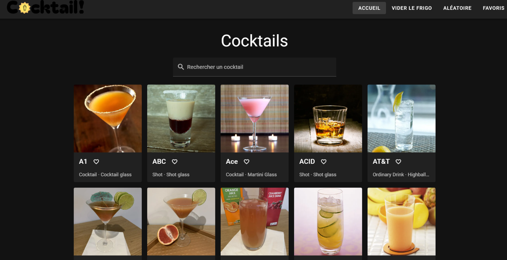

# 🍸 CocktailDB — Projet Vue.js & Vuetify (M294)

## 1. 🎨 Présentation du projet

### Concept
- **API choisie** : API cocktails basée sur les données de TheCocktailDB.
- **Pourquoi** : des données riches (ingrédients, mesures, verre, catégorie, image), parfaites pour faire de la recherche et des filtres. (J'aime aussi l'alcool)
- **Public cible** : les adultes qui veulent trouver un cocktail à faire chez eux avec ce qu'ils ont sous la main.
- **Objectifs** : chercher un cocktail par son nom, trouver ce qu'on peut faire avec les ingrédients du frigo, se laisser surprendre par un tirage aléatoire et garder ses cocktails préférés.

### Fonctionnalités principales
- **Accueil** : liste de tous les cocktails sous forme de cartes, avec un bouton « Voir plus » (24 par 24).
- **Recherche** : recherche en direct par nom de cocktail.
- **Vue détail** : popup avec le nom, la catégorie, le verre, les ingrédients avec leurs mesures, la préparation et l'image.
- **Vider le frigo** : on choisit des ingrédients classés en 5 catégories (alcools forts, liqueurs/vins/bières, sans alcool, fruits/herbes, épices/cuisine). Le site affiche les cocktails qui contiennent **tous** les ingrédients choisis.
- **Aléatoire** : un cocktail au hasard, ou une liste de 2 à 8 ingrédients au hasard (toujours avec au moins un alcool).
- **Favoris** : un cœur sur chaque carte ajoute ou retire un cocktail des favoris, avec une page dédiée.
- **Persistance locale** : les favoris sont sauvegardés dans le `localStorage` et restent après un refresh.

### Aperçu visuel


---

## 2. 📚 Parcours d'apprentissage

### Ressources utilisées
#### Documentation & tutos
- [Vue 3 Docs](https://vuejs.org/guide/introduction.html)
- [Vuetify Docs](https://vuetifyjs.com/en/components/all/)
- [Pinia Docs](https://pinia.vuejs.org/)
- [Axios Docs](https://axios-http.com/docs/intro)
- [MDN — Array (filter, map, every, flatMap)](https://developer.mozilla.org/fr/docs/Web/JavaScript/Reference/Global_Objects/Array)
- [MDN — localStorage](https://developer.mozilla.org/fr/docs/Web/API/Window/localStorage)

#### Progression
- Semaine 1 : _Création de fetchAll, ma méthode principale et idée de pages_
- Semaine 2 : _Store Pinia et page d'accueil_
- Semaine 3 : _Header, footer, et catégorie d'ingrédients_
- Semaine 4 : _Aléatoire, « Vider le frigo », favoris et popup_

---

## 3. 🛠️ Outils et méthodologie

### Environnement de développement
- **IDE** : WebStorm
- **Versioning** : Git + GitHub
- **Dépendances principales** : Vue 3, Vuetify 3, Pinia, Vue Router (routing par fichiers), Axios, Vite
- **Gestion de l'URL de l'API** : `.env` + `.env.example`

### Installation & Run
```bash
# Cloner le repo
git clone https://github.com/Hasan-Erdogdu/294-projet-cocktaildb-erdohas.git
cd 294-projet-cocktaildb-erdohas

# Installer
npm install

# Variables d'environnement : copier .env.example → .env
cp .env.example .env

# Lancer
npm run dev
```

Contenu du `.env` :
```
VITE_API_URL=https://apis.divtec.me/api/cocktails/
```

> ⚠️ Après une modification du `.env`, il faut relancer `npm run dev`.

### Méthodologie
- Découpage en composants réutilisables (`SmallCocktailCard`, `CocktailCard`, `AppHeader`, `AppFooter`)
- Props pour donner le cocktail aux cartes
- Store global avec Pinia
- Commits réguliers
- Tests manuels

### Choix techniques
- **API sélectionnée** : `https://apis.divtec.me/api/cocktails/`
- **Justification** : données complètes, instructions en français, images incluses.
- **Endpoints utilisés** :
  - `GET /cocktails?page=X&limit=100`
  - `GET /ingredients?page=X&limit=100`
- **Limites connues** : maximum **100 éléments par page**. Il faut donc 5 requêtes pour les cocktails et 4 pour les ingrédients, lancées en parallèle avec `Promise.all`.
- **Tout charger au départ** : avec 441 cocktails, il est plus simple et plus rapide de tout charger une fois puis de filtrer côté client (recherche, frigo, favoris) que de refaire une requête à chaque action.
- **Catégories d'ingrédients** : l'API ne classe pas les ingrédients, donc `utils/ingredientCategories.js` les classe avec des mots-clés (mot entier, la première catégorie trouvée gagne) et quelques exceptions (ex. « Ginger beer » est sans alcool).

### Architecture

```
src/
├── App.vue                  → lance store.init() au démarrage
├── layouts/default.vue      → header, chargement / erreur, page, footer
├── pages/
│   ├── index.vue            → liste + recherche par nom
│   ├── fridge.vue           → « Vider le frigo »
│   ├── aleatoire.vue        → cocktail / ingrédients aléatoires
│   └── favoris.vue          → cocktails favoris
├── components/
│   ├── AppHeader.vue        → logo + navigation
│   ├── AppFooter.vue        → message de prévention
│   ├── SmallCocktailCard.vue→ carte dans la grille (+ bouton cœur)
│   └── CocktailCard.vue     → détail dans le popup
├── stores/cocktailStore.js  → state, getters, actions (Pinia)
├── utils/ingredientCategories.js → classement des ingrédients
└── plugins/axios.js         → instance Axios avec VITE_API_URL
```

Outil utilisé pour les maquettes : Figma.

**Data-flow résumé :**
1. Au démarrage, `App.vue` appelle `store.init()` → le store charge cocktails et ingrédients via Axios et lit les favoris dans le `localStorage`.
2. Pendant le chargement, le layout affiche un spinner. En cas d'erreur, il affiche une alerte avec un bouton « Réessayer ».
3. L'utilisateur tape ou clique (recherche, ingrédient, cœur) → la page appelle un **getter** (`searchByName`, `searchByIngredients`) ou une **action** (`toggleFavorite`, `pickRandomCocktail`) du store.
4. Le store met à jour son état → Vue met à jour l'affichage automatiquement.

---

## 4. 🧪 Tests et validation

### Tests techniques
- ✅ Les 441 cocktails et 310 ingrédients sont bien chargés
- ✅ Les favoris restent après un refresh (`localStorage`)
- ✅ Navigation entre les 4 pages OK
- ✅ Recherche insensible aux majuscules
- ✅ Le frigo ne garde que les cocktails qui ont **tous** les ingrédients choisis
- ✅ `npm run build` passe sans erreur

### Tests d'UX
- Navigation simple avec 4 liens dans le header
- Recherche en direct, sans bouton à cliquer
- Ingrédients choisis affichés en chips, avec « Tout effacer »
- Feedback : spinner au chargement, alerte en cas d'erreur, messages quand rien n'est trouvé

### Tests d'accessibilité
- Thème Vuetify avec un bon contraste
- `alt` sur toutes les images de cocktails
- `aria-label` sur le bouton cœur (« Ajouter aux favoris » / « Retirer des favoris »)
- `lang="fr"` sur la page
- Boutons Vuetify utilisables au clavier, avec un focus visible

### Tests d'erreurs & fallback
- API down → alerte d'erreur avec un bouton « Réessayer »
- Recherche sans résultat → « Aucun cocktail trouvé. »
- Frigo sans correspondance → message clair
- Aucun favori → message sur la page Favoris
- `localStorage` illisible → les favoris repartent d'une liste vide, sans planter le site

---

## 5. 🤖 Usage d'intelligence artificielle

### IA utilisée
- **Nom** : Claude (Anthropic)
- **Version** : Haiku 5.5, Opus 5.5, Fable 5.2
- **Contexte** : explications, idées de logique, debugging et génération de certaines parties de code

### Utilisation détaillée
**Domaines d'aide :**
- Aide au code général : _25 %_
- Génération de snippets Vue/Vuetify : _20 %_
- Aide à la structuration du projet : _30 %_
- Debugging : _10 %_
- Recherche d'idées : _10 %_

**Compréhension et adaptation**
- Explications de Vue, Pinia (state / getters / actions), `ref`, `computed`, promesses, `await`, `Promise.all` et `flatMap`.
- Debugging : spinner infini causé par une deuxième instance de Pinia dans `main.js`, popup qui s'ouvrait en double, balises mal fermées, `@click.stop` pour que le cœur n'ouvre pas le popup.
- Génération : la liste de mots-clés pour classer les 310 ingrédients, le CSS du layout du frigo et du footer, les commentaires JSDoc.

### Parties codées manuellement
- Composants principaux : _80 %_ personnel
- Store & persistance : _80 %_ personnel
- Routing & navigation : _80 %_ personnel
- Tests & validation : 100 % personnel

### Apprentissage personnel
- J'ai beaucoup appris sur VueJS
- J'ai bien aimé utiliser ce framework, Pinia et Axios
- Je ne savais pas qu'on pouvait avoir une seule page index.html

---

## 6. 🎯 Bilan personnel

### Ce que j'ai appris
- Organiser une application avec un store Pinia plutôt que de faire les requêtes dans chaque page
- Gérer une API paginée avec plusieurs requêtes en parallèle
- Utiliser les méthodes de tableau (`filter`, `map`, `every`, `flatMap`) et les `Set`
- Utiliser Axios pour la simplification de fetch pour des API

### Difficultés rencontrées
- Comprendre la différence entre state, getters et actions
- Les bases du VueJS
- L'URL des images, qui n'était pas au même endroit que l'API
- Classer 310 ingrédients sans catégorie fournie par l'API

### Réussites et fiertés
- La page « Vider le frigo »

### Améliorations possibles
- Popup de vérification de l'âge au premier chargement
- Thème sombre « bar » personnalisé
- Animation sur le cocktail aléatoire
- Cacher les ingrédients qui ne sont utilisés dans aucun cocktail

---

## 7. 📚 Références & Sources
- Données d'origine : [TheCocktailDB](https://www.thecocktaildb.com/)
- API utilisée : API fournis par l'école
- Docs : Vue 3, Vuetify 3, Pinia, Axios, MDN (voir section 2)
- Usage de l'IA : voir section 5
- Prévention : [Addiction Suisse](https://www.addictionsuisse.ch/)
